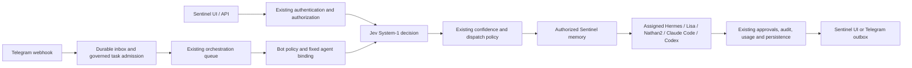

# Jev System-1 routing

Sentinel reuses `src/lib/system-one`: one batched TypeSafe evaluation, the existing confidence policy, circuit breaker, decision table and metrics API. The repository default is now `active`. Jev classifies; the assigned runtime and its primary reasoning model execute. No new queue, executor, memory store or model substitution policy is introduced.



The Telegram branch is a prerequisite for that channel. Its native-consumer cutover and trusted Hermes execution boundary must be verified before enabling it. This diagram does not claim a completed live cutover.

## Audit findings (2026-10-18)

- Development/code and Compose previously defaulted to `off`; presence of the provider did not activate it.
- Running app: global `shadow`, Nathan2 override `active`, Lisa inherited shadow; direct TypeSafe endpoint, configured `jev-latest`. Runtime chat forcibly recorded active as shadow and ran classification concurrently with execution. Thus Nathan2's setting did not enforce a pre-dispatch decision there.
- Running orchestration worker: no System-1 configuration or key. Bot tasks, delegated orchestration, collaboration turns, session-message API and bot proposal generation bypassed the existing classifier.
- Direct-model chat and voice reasoning already used System-1. Voice's existing explicit read-only fast path is preserved. Health, discovery, empty session creation, cancellation, internal maintenance/learning experiments and local CLI invocations are not user request classification surfaces.
- Native Hermes Telegram consumers and dashboards are outside the Sentinel request boundary. Repository changes cannot establish exclusive production routing while those paths remain live. See [Telegram cutover and blockers](telegram/GATEWAY.md).

## Dispatch coverage and policy

| Entry point | Classification boundary | Execution policy |
|---|---|---|
| Direct-model `/api/chat` | After existing user/room/agent access checks | Active mode awaits classification; may omit unnecessary memory retrieval, never expand access |
| Runtime chat, including voice's existing runtime call | `routeRuntimeChat`, after runtime and session scope authorization | Retain assigned agent/model, dispatch System-2 |
| `/api/agent-sessions/:id/messages` | After owner/runtime execution authorization | Retain session and pinned model |
| Collaboration, direct mentions and delegated worker turns | `runAgentTurn`, after runtime authorization | Preserve existing lead, worker selection and worktree rules |
| Queued runs, bot tasks, Telegram | Existing orchestration executor, after bot policy and runtime verification | Same queue and tool authorization callback; bot memory policy is mandatory |
| Bot proposal generation | Authorized generation service dispatch | Same selected host and generation behavior |
| Existing voice reasoning | Existing voice System-1 implementation | No unrelated Telnyx or GPT-Live changes |

The existing voice handler shares its already-classified turn through a server-owned async scope, matching user, agent and request exactly; the runtime call does not pay for a second classification. No client parameter can create that scope.

`classifyDispatch` extends the existing turn/service seam. It supplies no connector tools, so classification cannot execute a tool or bypass bot approvals. It records the assigned agent/model as immutable constraints. Existing capability/workload selection remains authoritative; Jev does not automatically reassign agents or choose a different model. The generated decision includes intent, complexity, System-2 probability, memory need and a metadata-only memory category recommendation.

Complex, coding, write and ambiguous requests remain System-2 work. A simple greeting also uses the assigned conversational model: Jev returns judgments, not user-facing prose. Only the existing explicitly configured voice read-only tool path can avoid System-2 calls. Enabling Jev therefore adds classifier cost on most requests; it does not guarantee net savings.

Memory category recommendations never become access grants or direct scope filters. The existing retrieval ACLs, provenance, confidence/contradiction handling, retention and bot memory policy own what may be retrieved/injected. Generic chat and non-bot queued runs may skip optional retrieval with high confidence. Bots always prepare their governed memory. No retrieved memory content is fetched for Jev. Requests are bounded to 4,000 characters; existing chat history input remains bounded to two short turns. Collaboration prompts may already contain authorized context prepared upstream; this change does not make Jev their memory authority.

## Provider and configuration

The live synthetic probes confirmed `api.typesafe.ai` serves the existing `jev-latest` setting as **`jev-1.13.0`**. Current [TypeSafe model documentation](https://docs.typesafe.ai/models) lists that version as stable and 1.14 as preview. The direct default pins `jev-1.13.0`; explicit model settings are preserved. HTTP uses the existing [System One endpoint](https://docs.typesafe.ai/api), not a text completion API.

| Variable | Default / behavior |
|---|---|
| `SYSTEM_ONE_ENABLED` | `true`; `false` is the hard kill switch, including per-agent overrides |
| `SYSTEM_ONE_MODE` | `active`; explicit `off`/`shadow` are retained |
| `SYSTEM_ONE_MODE_<AGENT>` | Optional override; e.g. `HERMES_LISA`, `HERMES_NATHAN2`, `CLAUDE_CODE`, `CODEX` |
| `SYSTEM_ONE_API_KEY` | Preferred key; then `TYPESAFE_API_KEY`, then legacy `OPENROUTER_API_KEY` |
| `SYSTEM_ONE_BASE_URL` | Direct `https://api.typesafe.ai`; OpenRouter-only key selects `https://openrouter.ai/api` when no URL is supplied |
| `SYSTEM_ONE_MODEL` | Direct `jev-1.13.0`; OpenRouter `~typesafe/jev-latest`; explicit value wins |
| `SYSTEM_ONE_TIMEOUT_MS` | 400; bounded 50–5000 ms, hard deadline even if provider ignores abort |
| `SYSTEM_ONE_VOICE_TIMEOUT_MS` | Existing 250 ms voice budget |
| `SYSTEM_ONE_HIGH_CONFIDENCE` / `_LOW_CONFIDENCE` | Existing .85 / .5 thresholds |
| `SYSTEM_ONE_NOUL_THRESHOLD` | Existing .9 threshold |
| `SYSTEM_ONE_FAST_PATH_SURFACES` | Existing `voice`; `none` disables all tool fast paths |
| `SYSTEM_ONE_BREAKER_FAILURES` / `_OPEN_MS` | Existing 5 failures / 30000 ms |

Compose passes identical routing settings and credentials to the app and orchestration worker. Existing production `.env` overrides are not rewritten automatically. Restart both processes when changing provider settings; their provider instance/breaker is process-local.

Provider failure, missing key, malformed answer, deadline or open breaker produce an explicit fallback: assigned System-2 agent/model with normal governed memory, permissions and approvals. There is no model fallback caused by Jev. The underlying runtime's existing independently authorized fallback policy remains unchanged. No retries occur inside the classifier budget.

## Observability and availability

Mission Control's System-1 health link opens `/system-one`. The existing authenticated `/api/system-one/metrics` returns caller-scoped aggregates and recent decision metadata; administrators retain the existing broader view. It includes effective agent modes, provider model, outcome, assigned agent/model, latency, token usage, reported cost, fallbacks, System-2 dispatch rate, cost estimates and shadow tool agreement. No prompts, memory contents or credentials are returned.

Queued runs persist the decision ID in `contextSnapshot.systemOne`; structured `system_one.dispatch` logs correlate it with the run. Actual dispatch and observed model/tool/token events update the same decision row. Decision persistence remains best effort under database failure, as in the existing telemetry service. Failed provider response bodies are not logged.

Availability is passive: a successful decision within 15 minutes is evidence, not merely a configured key. Missing/stale success is unverified, an open breaker is down and high fallback rate is degraded. Health and maintenance never call Jev as a prerequisite. Operators can run the synthetic read-only provider check:

```sh
node_modules/.bin/tsx scripts/system-one/probe.ts
```

The probe uses configured credentials and four synthetic coding requests, never an agent execution. Existing labeled routing evaluation remains `node_modules/.bin/tsx bench/system1/run.ts --repeat 3` (optional tool execution requires its separate `--tools` flag). Shadow tool agreement is a proxy, not measured routing accuracy. Provider responses without price leave cost unknown; net savings are unknown when successful decisions are unpriced.

## Deployment and rollback

1. Review the dedicated Jev PR and prerequisite Telegram PR separately. Resolve inherited build/security findings and the gateway's execution-boundary/cutover blockers before enabling Telegram.
2. Configure a valid provider key, URL and provider-appropriate model. To use the verified direct provider: `SYSTEM_ONE_BASE_URL=https://api.typesafe.ai`, `SYSTEM_ONE_MODEL=jev-1.13.0`.
3. Set `SYSTEM_ONE_ENABLED=true`, `SYSTEM_ONE_MODE=active`; review/remove per-agent `off`/`shadow` overrides intentionally. Merely deploying the new code will not override production's current explicit `shadow` value.
4. Build the reviewed immutable release and restart app and orchestration worker with the same config. No Jev schema migration is required: the existing `system_one_decisions` model and run context JSON suffice. The prerequisite gateway has its own additive migration.
5. Run the synthetic provider probe, then authenticated UI/API checks for each runtime. Inspect recent decision rows and correlated task IDs. Verify the actual primary models remain unchanged and bot tool approvals still hold execution.
6. Follow the gateway's controlled live procedure before claiming Lisa/Nathan2 Telegram routing works. Verify only one native update consumer per bot and the trusted pre-tool proof. Do not disable the working bots prematurely.

Rollback: set `SYSTEM_ONE_ENABLED=false` on app and orchestration worker and restart both. This preserves existing runtime authorization and bot approvals while restoring pre-classifier dispatch. Per-agent `shadow`/`off` are narrower options; no decision rows are removed. Telegram rollback is a separate controlled operation documented in its gateway guide.

See [verification results and remaining release gates](SYSTEM_ONE_VERIFICATION.md).
