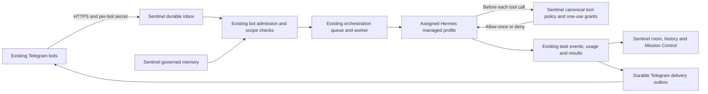

# Telegram gateway for Lisa and Nathan2

Status: implemented for review, **not deployed or verified end to end against live
Telegram/Hermes**. Keep both production feature flags false until the cutover
below. Do not merge/deploy around the outstanding build and live-verification
gates. Existing Telegram consumers were not stopped or changed during this work.

## Architecture findings

Audited `origin/main` at `f5d05a0`, repository runtime adapters/registry,
`routeRuntimeChat`, bot task admission/execution/approvals/memory, orchestration
queue and worker, learning scheduler, chat persistence and scope authorization,
Docker/Traefik/release configuration, and relevant existing tests.

Read-only inspection of the actual Hostinger VPS (`srv1427612`) confirmed:

| Identity | Runtime | Existing Telegram identity | Current consumer |
| --- | --- | --- | --- |
| Lisa | `hermes-lisa`, dashboard `127.0.0.1:4862` | `8768848729`, `@Lisa_surfbot` | Hermes webhook on `hermes-lisa.srv1427612.hstgr.cloud` |
| Nathan2 | `hermes-nathan2`, dashboard `127.0.0.1:4864` | `8790562826`, `@Titanicf_bot` | Hermes polling; Telegram webhook URL empty |

Both containers use Hostinger's Hermes image, host networking, individual
`/docker/hermes-{lisa,nathan2}/data` homes, supervised gateway/dashboard processes,
and shared host patches. The inspected image ID is
`sha256:03295aaee23c04ab037ef46f9f1efe89bab9852d3135b1b69102c1b0ad646bb0`.
Lisa's native gateway also has an enabled SMS platform; Nathan2's enabled platform
list contains only Telegram. A blanket Lisa gateway stop would therefore risk
unrelated messaging and is not an acceptable cutover shortcut. Both original profiles have native memory and user
profile memory enabled. Tokens remain in protected original configuration; none
were printed or committed. Read-only `getMe` and `getWebhookInfo` calls confirmed
identity and current delivery mode, with zero pending Telegram updates at audit
time. This was **not** an end-to-end message test.

Sentinel already supplies normal rooms/messages, scoped/provenanced memory
retrieval and ingestion, bot permission policies and one-use grants, immutable bot
configuration checkpoints, durable orchestration tasks, Redis ownership leases,
confirmed cancellation, audit events and usage accounting. Its deployed bot tool
path detects calls after they start; that is insufficient for Telegram routing.
There was no existing Sentinel Telegram ingress to extend.

Open PRs inspected: #49 (Telnyx), #41 (shell/live task/memory graph), #21 (learning
release audit), #17 (memory/skills/governance). No Telnyx/voice files changed.
This branch reuses the pre-call authorization implementation inspected in the
parallel `/root/sentinel-bot-preexec` worktree, rather than inventing another
permission policy. Coordinate those overlapping shared adapter/executor changes
before merging either branch. The routine branch remains untouched.



The existing learning scheduler wakes transport admission/reconciliation every
10 seconds. It never executes agents. `delegateToBotIn` uses the same admission,
caller/delegation policy, task insertion, event sanitization and audit conventions
as `delegateToBot`; inbox/task linkage commits with the task before enqueue.
The existing orchestration queue/executor owns execution, retries and leases.
There is no new queue or independent agent router. Other runtime adapters retain
the same control-plane contracts; no Claude Code/Codex implementation was replaced.

## Implemented behavior

- Fixed Lisa/Nathan2 identity bindings, verified against bot IDs; credentials are
  referenced by environment/secret-file names, never stored in the database.
- Timing-safe per-bot webhook secret validation, bounded request bodies, explicit
  sender **and** private-chat mappings to a Sentinel user. Current workspace
  execution permission is checked at receipt, admission, session use and tool
  authorization. Messages cannot set runtime/user/workspace/parent-task authority.
- Authenticated receive-only mode: acknowledge after PostgreSQL commits, including
  during Redis outages. Native INSERT conflict handling deduplicates simultaneous
  Telegram retries by bot/update and bot/chat/message. Invalid authentication is
  rejected; database failure is 503 so Telegram retries.
- Durable pending admission, linked task recovery and existing BullMQ job IDs.
  Transaction locks plus partial unique indexes allow only one admitted task per
  conversation, including approval waits. Additional messages backlog in order.
  Bot concurrency/budget saturation waits; it does not silently lose the message.
- Original chat/message/reply IDs, media IDs, original filename/MIME metadata and
  source bot remain in the inbox. Media downloads are bounded to 20 MB, use fixed
  Telegram hosts and bounded streams, and never pass token-bearing URLs to models.
  Supported inputs: text, voice, audio, photos, documents and videos. Media is
  staged under an immutable per-update path on a readonly Hermes mount.
- The plugin adds `sentinel_transcribe_audio`, a normal gated tool backed by
  Hermes' existing `tools.transcription_tools.transcribe_audio`; it builds no new
  telephony/live-audio system. Vision reuses `vision_analyze`. Both require explicit
  Sentinel grants/approvals. Unsupported/oversized inputs produce recorded errors.
- Normal `ChatRoom`/`Message` history, bounded context from recent turns, and UI
  follow-ups through the same inbox/task path. Legacy direct-runtime/collaboration
  paths refuse Telegram-backed rooms rather than bypassing the channel gate.
- `/telegram` uses the existing design primitives and task detail component:
  connections, checked webhook health, conversations, original/reply message IDs,
  execution history, tool stages, approval decisions, memory events, errors,
  delivery receipts and uncertain delivery. Attachments have authenticated download
  endpoints and expire seven days after terminal completion.
- Approval waits retain the conversation slot and notify Telegram. Approvals are
  made in existing authenticated Sentinel UI, never from Telegram permission
  claims. Continuations keep server-owned channel identity; their real outcome is
  delivered once. Existing task cancellation, memory and cost accounting apply.

## Trusted execution and memory ownership

The root-mounted `sentinel-bot-gate` plugin runs before Hermes tool dispatch. It
uses Hermes' native blocking approval/server-request mechanism, not an advisory
prompt or an observed `tool.start`. Sentinel answers only `once`/`deny`; repeated
server-request IDs are denied, canonical identities must be unambiguous, current
permissions are reloaded, and one-use grants are consumed through existing atomic
conditional writes. Unknown identities, absent authorizers, runtime-side approval
questions, disconnects, exceptions and hook timeouts fail closed.

Every Telegram turn requires a fresh nonce proof from the authenticated host's
`sentinel-gate-status` command, matching the exact managed profile and per-update
session source. Proof is checked before session use and before a recovered
session's prompt. An environment flag by itself does not assert enforcement.
A missing/false proof prevents the model prompt. An unasked observed call remains
a reported security violation; **it is not described as having been prevented**.

The managed profile inherits the original model/personality configuration and
`SOUL.md`, but has local memory/user-profile memory and external memory providers
disabled. It receives only Sentinel's permitted bot/user/shared workspace memory
through `readBotMemory` and writes through `writeBotMemory`/`remember`, preserving
provenance, ingestion confidence, contradiction/reconsolidation, retention and
forgetting policies. Conversation persistence is separate from durable semantic
memory. No MEMORY.md, USER.md, state database, sessions or arbitrary native memory
is copied or synchronized. Existing Hermes conversations remain intact; selected
prior turns can be explicitly reviewed/imported as described below.

The plugin also guards original native Telegram dispatch after cutover via a
root-owned, readonly `/run/sentinel-telegram-owned` marker. Install the **same
plugin in the original gateway profile** as well as the managed profile. With
that marker, a resurrected native Telegram consumer cannot dispatch agent turns.
The marker is also required for the trusted Telegram session proof. Other native
platforms are not intercepted by this dispatch hook.

Telegram's initial isolated tool surface is intentionally limited: web search/
extraction, installed skill reads, todo/clarification, current-update media reads,
vision/video and the gated transcription wrapper. Shell/code execution, arbitrary file
writes, native memory/history, native delegation/cron and arbitrary MCP tools are
blocked even by broad grants. Do not expand it without a separate sandbox/trust
review: those tools could otherwise remove a guard, read credentials, or re-enable
an uncontrolled Telegram path. Original runtime capabilities remain unchanged
outside these managed sessions. This limit is not a claim that general Hermes
shell execution is sandboxed by this PR.

## Configuration

Use the opt-in `docker-compose.telegram.yml` overlay. Existing deployments do
not require any new secret files unless the overlay is selected.

| Variable | Purpose |
| --- | --- |
| `TELEGRAM_WEBHOOKS_ENABLED` | Authenticated durable intake, default false |
| `TELEGRAM_GATEWAY_ENABLED` | Admission and outbound delivery, default false |
| `TELEGRAM_WEBHOOK_ORIGIN` | HTTPS Sentinel origin, no path/trailing slash |
| `TELEGRAM_MEDIA_HOST_DIR` | Private shared host staging directory |
| `TELEGRAM_MEDIA_ROOT` | App/learning-worker container staging path |
| `TELEGRAM_LISA_TOKEN_FILE`, `TELEGRAM_NATHAN2_TOKEN_FILE` | Compose host secret files holding the unchanged existing tokens |
| `TELEGRAM_LISA_SECRET_FILE`, `TELEGRAM_NATHAN2_SECRET_FILE` | Independent new webhook secret files |
| `TELEGRAM_<LISA\|NATHAN2>_BOT_TOKEN_FILE` | Application/CLI secret-file reference; overlay supplies `/run/secrets/...` |
| `TELEGRAM_<LISA\|NATHAN2>_WEBHOOK_SECRET_FILE` | Application/CLI secret-file reference |
| `HERMES_<LISA\|NATHAN2>_BOT_TOOL_GATE` | `pre-execution` in orchestration worker |
| `HERMES_<LISA\|NATHAN2>_TELEGRAM_PROFILE` | `sentinel-lisa` / `sentinel-nathan2` |

Existing `DATABASE_URL`, `REDIS_URL`, `BULLMQ_PREFIX`, runtime endpoint/auth/model/
workspace variables remain authoritative. The overlay gives bot tokens to app
(health/intake) and learning worker (download/delivery), **not** to Hermes or the
orchestration worker. Secret environment variables without `_FILE` are supported
for isolated development; prefer root-protected mounted files in production.
Only `TELEGRAM_LISA_*`/`TELEGRAM_NATHAN2_*` known references are accepted.

Limits: private chats only; no groups/topics, callback menus or edited-message
execution. Fixed aliases are the existing Lisa/Nathan2 identities. Bot tokens,
webhook secrets, raw fetch errors and Telegram error descriptions are suppressed
from logs/API errors. File retention is seven days after terminal completion.

## Safe cutover — one bot at a time

These steps are **not executed by this PR**. Schedule a window with no active
voice/agent turn; do not change Telnyx/voice configuration. Record the release SHA,
container image digests, old webhook URL/secret, old polling offset/receipt state,
profile paths and protected config backups before changing consumers.

1. Resolve the build blocker and consolidate the overlapping authorization work.
   Deploy a verified release with both feature flags false, using the release
   script's existing immutable SHA tags and migration step. Apply the additive
   migration first. Do not delete tables during rollback.
2. Secure `/etc/sentinel/telegram` as root-only. Copy the **existing** bot tokens
   into `lisa-token`/`nathan2-token` files without printing them or issuing new
   identities. Set files readable by the app/worker group (root:1001, mode 0440;
   parent mode 0700). Generate independent webhook secrets, for example with
   `openssl rand -hex 32`, directly into the protected files. Avoid shell tracing.
   Create the staging directory root:1001 mode 0750. Mount it readonly at
   `/sentinel-media` in each Hermes container and add supplemental group 1001.
3. Pin and audit the Hermes image actually running: this plugin was written against
   the inspected host's `pre_tool_call`, `command.dispatch`, `register_command`,
   profile scoping and approval/server-request APIs. Mount this repository's plugin
   directory readonly at `/opt/sentinel-gate`. Do not let any agent rewrite it.
4. Create blank managed profiles using Hermes' installed CLI:
   `hermes profile create sentinel-lisa --no-skills` (Lisa container) and
   `hermes profile create sentinel-nathan2 --no-skills` (Nathan2 container).
   Use the actual profile paths reported by that CLI. Run, using Hermes' Python:

   ```sh
   python scripts/telegram/prepare-profile.py ORIGINAL_HOME MANAGED_HOME /opt/sentinel-gate
   ```

   The preparation script refuses to overwrite a used profile and copies no
   credentials or memory/history. Provision only the needed existing model/STT/
   vision credentials through protected launch configuration. Validate their
   primary model/personality against the source; do not rotate model selection.
   Register the same readonly plugin in the original profile's `plugins.enabled`
   list too, preserving its other entries and configurations. Verify discovery
   after a planned/drained gateway reload. Do **not** mount the ownership marker
   or disable the working Telegram consumer yet.
5. In Sentinel's Bots UI, select/create a policy wrapper for each existing Hermes
   runtime in its existing workspace. Leave model overrides and personality text
   empty so the runtime keeps its established configuration. Review explicit tool
   grants and bot/user/workspace memory scopes; keep delegation disabled. Bind an
   actual authorized Sentinel user to each numeric Telegram sender/private chat:

   ```sh
   npx tsx scripts/telegram/configure.ts register lisa SENTINEL_BOT_ID SENTINEL_USER_ID TELEGRAM_USER_ID TELEGRAM_CHAT_ID
   npx tsx scripts/telegram/configure.ts register nathan2 SENTINEL_BOT_ID SENTINEL_USER_ID TELEGRAM_USER_ID TELEGRAM_CHAT_ID
   ```

   Run operator CLIs with a protected environment holding the existing database,
   runtime auth and secret-file references. Never place token values in arguments.
   Repeat registration for each explicitly authorized sender. The command verifies
   `getMe` against the audited existing bot ID and refuses identity retargeting.
6. Preserve conversation continuity explicitly: export only the intended native
   Telegram session's visible user/assistant turns to a protected JSON file:
   `{agentId, telegramChatId, senderId, messages:[{role:"user"|"assistant",content,at:ISO8601}]}`.
   Review it, verify its source chat/agent/user, and calculate its SHA-256. While
   the binding is paused, run:

   ```sh
   npx tsx scripts/telegram/import-history.ts lisa REVIEWED_EXPORT.json REVIEWED_SHA256
   ```

   Repeat for Nathan2 as applicable. The bounded, idempotent import creates/reuses
   a normal room and records provenance/audit; it does not ingest native memories,
   tools/system prompts or other users' conversations. Preserve original files.
7. Deploy the opt-in Compose overlay and Traefik webhook router with
   `TELEGRAM_WEBHOOKS_ENABLED=true`, `TELEGRAM_GATEWAY_ENABLED=false`. Check HTTPS,
   secret rejection, database health and the existing workers. First verify the
   complete path using an isolated test bot/runtime or the automated fake runtime;
   do not point the existing identities at an untested public listener.
8. For **one** production bot, drain its existing native Telegram turns and delivery
   queue. Record the old webhook/polling state. Mount the root-owned readonly
   `/run/sentinel-telegram-owned` marker in that container, and validate the native
   dispatch guard with a controlled authorized message before proceeding. Quiesce
   its native Telegram adapter using the installed Hermes gateway's supported
   platform configuration/service controls; retain its data/offsets for rollback.
   Do not stop/reconfigure other platform integrations or dashboard runtimes.
   Remove the old `/telegram` public webhook ingress and move Telegram token access
   out of the executing profile once the replacement is verified. Keep a protected
   rollback copy. Never run two consumers or drop pending updates.
9. Switch the existing bot to the durable receive-only Sentinel webhook:

   ```sh
   npx tsx scripts/telegram/configure.ts webhook lisa
   ```

   This uses `drop_pending_updates:false` and secret-token authentication. Verify
   an authorized test message is stored once and no runtime task is started.
   Check `getWebhookInfo` points exactly to the Sentinel URL. The webhook replaces
   polling at Telegram, but that is not a substitute for draining/disabling the
   old native consumer and verifying the ownership guard.
10. Run the empty-session protocol canary, with no model prompt/tool action:

    ```sh
    npx tsx scripts/telegram/verify-runtime.ts lisa
    ```

    It must report a matching managed profile/source and trusted gate. Verify the
    host's negative tool canary in staging too: disable/remove the plugin or local
    memory isolation and confirm Sentinel refuses the session before prompting.
11. Record these checks and enable that binding explicitly:

    ```sh
    TELEGRAM_VERIFIED_CUTOVER=lisa:verified npx tsx scripts/telegram/configure.ts enable lisa
    ```

    Enable the global execution flag through the verified Compose deployment.
    Run the live verification below. Then repeat the controlled process for
    Nathan2. Do not declare either identity live before its actual reply and
    security/continuity checks pass. Enabling requires the webhook to match;
    every runtime turn still independently checks the trusted host proof.

The exact native platform-disable command depends on the installed Hermes gateway
version and which profile owns the adapter. Confirm its installed configuration
interface during the cutover window; **do not substitute a blanket gateway stop**
that could interrupt unrelated integrations. That operational check remains a
production gate, not an unverified command invented here.

## Live verification procedure

For each original bot, send a unique harmless text from an allowlisted private
account; record Telegram update/message IDs, Sentinel room/task IDs, actual runtime
agent/session/model, memory retrieval attribution, and outbound message ID. Confirm
Lisa never creates a Nathan2 task and vice versa. Confirm the same room contains
both sides in Sentinel. Continue from Telegram Mission Control and verify its
reply reaches that same private chat.

Replay the identical webhook using a protected test harness (do not log its
secret/body); task/session counts must not increase. An unlisted sender and wrong
webhook secret must create no task. Send a voice message, photo and small document;
verify bounded staging, approved transcription/vision/read behavior and source
chat reply. Confirm another sender's media/history is inaccessible.

Request a staging-only safe approval-gated tool. Confirm no side effect before
approval, one side effect after a single authenticated UI approval, and refusal on
approval replay/forged parent identity. Revoke the sender/grant during an active
staging task and confirm the next tool is denied. Verify native memory/history,
terminal/code and direct native Telegram dispatch cannot bypass the guard.

Interrupt/restart isolated workers between inbox commit, admission commit,
enqueue and result persistence; confirm one task/session, retained conversation
and safe recovery. Simulate a known 429 and an ambiguous delivery response; check
retry scheduling versus visible uncertain status. Test cancellation and confirm
runtime stop before releasing its slot. Perform outage/negative tests in staging,
not by killing production dependencies.

## Delivery guarantees and rollback

Exactly-once **agent admission** is enforced by inbox uniqueness, transactional
linkage, per-conversation constraints and existing task/queue execution ownership.
No replay automatically starts another session after side effects.

Telegram `sendMessage` has no idempotency key. Explicit 429s are durably retried
with `retry_after`; permanent errors are failed. A transport error, 5xx/invalid
receipt or crash after sending is `uncertain` and is **not** automatically retried.
Inspect the original chat and receipt before an operator sends anything again.
Per-bot pacing and chunk sequencing limit API pressure. Responses exceeding 30
chunks point to the complete Sentinel history rather than silently truncating it.

To roll back, first pause the Sentinel binding (UI or `configure.ts pause KEY`).
Cancel/drain its queued/running/waiting/cancelling tasks in the existing task UI;
verify runtime interruption is confirmed. Inspect unsent/uncertain outbox records
and pending inbox rows; do not forward admitted requests into the old consumer.
The rollback CLI refuses to restore the old consumer while Telegram tasks remain
in flight.

For Lisa, supply the **previous** webhook URL and protected prior secret file:

```sh
TELEGRAM_PREVIOUS_WEBHOOK_URL=PREVIOUS_HTTPS_URL \
TELEGRAM_PREVIOUS_WEBHOOK_SECRET_FILE=PROTECTED_PREVIOUS_SECRET_FILE \
npx tsx scripts/telegram/configure.ts rollback lisa
```

For Nathan2 (previously polling), omit those variables and run
`npx tsx scripts/telegram/configure.ts rollback nathan2`; it deletes the Sentinel
webhook without dropping updates. Restore the protected original Telegram token/
platform settings, remove the ownership marker only after Sentinel execution is
paused/drained, restore the prior ingress for Lisa, and resume only that bot's
original adapter/offset state. Verify its actual reply. Keep all Sentinel history,
dedupe records and migration tables; image rollback uses the existing release SHA
procedure. Pending Sentinel inbox entries are retained for manual reconciliation,
not blindly replayed into Hermes.

## Verification and recommendation

Commands executed and exact results are recorded in `VERIFICATION.md`. No live
send, webhook change, production migration, bot pause, runtime profile change or
deployment was performed. Read-only identity/webhook checks are not live success.

**Recommendation: keep the PR draft; do not merge/deploy yet.** Resolve the
pre-existing production build failure, reconcile the parallel authorization
changes, verify the plugin/profile and supported platform-quiesce controls on the
pinned Hermes image, and complete both bots' staged/live verification and rollback
drill. The implementation refuses production execution until configured and
verified; it does not assert those external gates have already been satisfied.
